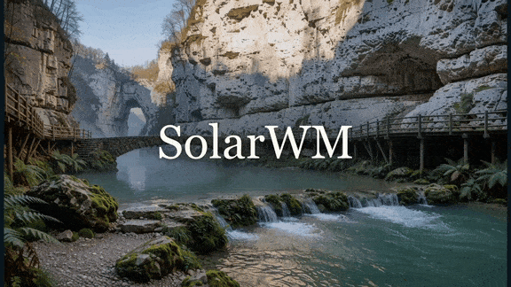

<p align="center">
  
</p>

<h3 align="center">Open Data · Scalable Training · Interactive World Models · Real-Time Deployment</h3>

**Solar** is an open framework for interactive world models, spanning open data,
scalable training, long-horizon video generation, and real-time deployment.
This repository contains code for [**SolarWM**](https://junchao-cs.github.io/SolarWM-Web/)
and [**SolarRenderer**](https://enderfga.cn/SolarRenderer).
See [Install](#install) for setup, [Data](#data) for datasets, and
[Documentation](#documentation) for training, inference, and deployment guides.

<p align="left">
  <strong>SolarWM</strong> &nbsp; <a href="https://junchao-cs.github.io/SolarWM-Web/"></a>
  <a href="https://arxiv.org/pdf/2609.02886"></a>
  <a href="https://huggingface.co/datasets/junchaoh-cs/SolarWM-Data"></a>
  <a href="https://modelscope.cn/datasets/junchao2003/SolarWM-Data"></a>
  <a href="https://docs.google.com/forms/d/e/1FAIpQLSfS-SLOiSRVDWwZ2kPl9ywN27aB6QplN0jpdKaBu-gG8aNsvQ/viewform"></a>
  <a href="https://huggingface.co/collections/junchaoh-cs/solarwm"></a>
  <a href="docs/solar_wm/"></a>
  <a href="deploy/solar_wm/"></a>
</p>

<p align="left">
  <strong>SolarRenderer</strong> &nbsp; <a href="https://enderfga.cn/SolarRenderer"></a>
  <a href="https://arxiv.org/abs/2610.28630"></a>
  <a href="https://huggingface.co/datasets/Enderfga/SolarRenderer-Data"></a>
  <a href="https://huggingface.co/Enderfga/SolarRenderer"></a>
  <a href="docs/solar_renderer/"></a>
  <a href="https://huggingface.co/spaces/Enderfga/SolarRenderer"></a>
</p>

<a id="demo-videos"></a>

## 🎬 Demo videos

<table class="demo-gallery">
<tr>
<td width="50%" align="center" valign="top">
  <a href="https://www.youtube.com/watch?v=dLwQ9LHMw-g">
    
  </a>
  <br>
  <strong>SolarWM</strong> · Real-time interaction, continuous exploration, and diverse generated worlds.
  <br>
  <a href="https://www.youtube.com/watch?v=dLwQ9LHMw-g">▶ Watch on YouTube</a>
</td>

<td width="50%" align="center" valign="top">
  <a href="https://enderfga.cn/SolarRenderer">
    
  </a>
  <br>
  <strong>SolarRenderer</strong> · Four-step, structure-conditioned video rendering.
  <br>
  <a href="https://enderfga.cn/SolarRenderer">Explore the project</a>
</td>
</tr>
</table>

<a id="news"></a>

## 📰 News

- **October 22, 2026:** We release **SolarWM-H3 Realtime** ([Blog](https://solarx-team.github.io/SolarWM-H3-Realtime/)), enabling **low-latency interactive video generation** from an image and a prompt, with real-time camera control ([Code](deploy/solar_wm/)).

- **October 16, 2026:** We release **H3 Streaming VAE Decoder** ([Blog](https://solarx-team.github.io/H3-Streaming-VAE-Decoder/)), enabling **low-latency streaming video decoding** that produces frames as latents arrive. It supports both the official MiniMax-H3 VAE and NVIDIA’s distilled StreamRender-H3 decoder ([Code](deploy/solar_wm/)).

- **October 16, 2026:** We release **SolarRenderer** ([Project](https://enderfga.cn/SolarRenderer) · [Paper](https://arxiv.org/abs/2610.28630)), bringing **four-step, structure-conditioned video rendering** with bidirectional and block-causal training and inference on MiniMax-H3. Follow the [SolarRenderer tutorial](docs/solar_renderer/README.md) to render from a structure video, an optional first frame, and a prompt.

- **September 13, 2026:** We release **SolarWM-H3** ([Guide](docs/solar_wm/backends/minimax-h3.md)), the first MiniMax-H3-based world model for **streaming, few-step interaction**. Training and inference code, [model weights](https://huggingface.co/junchaoh-cs/SolarWM-H3-33B), and [pre-encoded training data](docs/solar_wm/latent-wds.md) are available for all three stages.

- **September 3, 2026:** We open-source **SolarWM** ([Project](https://junchao-cs.github.io/SolarWM-Web/) · [Paper](https://arxiv.org/abs/2609.02886)), releasing **[1.43M video clips](docs/solar_wm/data-access.md)**, the data pipeline, and training and inference code with [model weights](https://huggingface.co/collections/junchaoh-cs/solarwm) for **four video backbones spanning 5B–33B**.

<a id="introduction"></a>

## 💡 Introduction

We introduce **Solar**, an open framework for interactive world modeling and generative video rendering:

- [**SolarWM**](https://junchao-cs.github.io/SolarWM-Web/): Open data and scalable training for **long-horizon, camera-controlled video world models**, backed by **1.43M clips (25 TB)** and an open data-processing pipeline. Supports four 5B–33B models across Wan2.2, LTX-2.5, and MiniMax-H3, with a shared training workflow and **real-time interaction with SolarWM-H3**.
- [**SolarRenderer**](https://enderfga.cn/SolarRenderer): **Four-step, structure-conditioned video rendering** on MiniMax-H3, supporting bidirectional and block-causal generation from a structure video, an optional first frame, and a prompt. Trained on **136K clips from eight sources**, with released training data and generalization benchmarks.

<a id="install"></a>

## 🛠️ Install

Set up the environment for your model or deployment using the guides below.
Each guide specifies the required Python, PyTorch, and CUDA versions.

| Use case | Installation guide |
| --- | --- |
| SolarWM · Wan2.2, LTX-2.5, or MiniMax-H3 | [Runtime environments](docs/solar_wm/environments.md) |
| SolarRenderer · training and inference | [SolarRenderer setup](docs/solar_renderer/README.md#install) |
| SolarWM-H3 · realtime interaction | [Realtime deployment](deploy/solar_wm/README.md) |

Activate your environment, then install Solar from the repository root:

```bash
python -m pip install -e .
solar --help
```

<a id="data"></a>

## 🗂️ Data

### SolarWM-Data

**1.43M clips · 25 TB · 14 sources**, with camera annotations, captions, and
quality metadata. The public release includes annotations, reconstruction tools,
and training recipes. Prepared raw video data can be requested through the
[access form](https://docs.google.com/forms/d/e/1FAIpQLSfS-SLOiSRVDWwZ2kPl9ywN27aB6QplN0jpdKaBu-gG8aNsvQ/viewform);
preencoded latents are distributed in separate releases.

- **Download:** [Hugging Face](https://huggingface.co/datasets/junchaoh-cs/SolarWM-Data) · [ModelScope](https://modelscope.cn/datasets/junchao2003/SolarWM-Data) · [Download & access](docs/solar_wm/data-access.md)
- **Data preparation:** [Dataset details](docs/solar_wm/datasets.md) · [Data pipeline](https://github.com/Enderfga/solarwm-data/tree/e7decd39cdbc0473a38e3d24716d3888569ccb62)
- **Training & evaluation:** [Preencoded latents](docs/solar_wm/latent-wds.md) · [Test set](https://huggingface.co/datasets/junchaoh-cs/SolarWM-Data_test-set-v1)

### SolarRenderer-Data

The training corpus contains **136K clips from eight sources**. The public
release provides **57,738 training clips** paired with structure videos,
first frames, and prompts, plus a **208-case generalization benchmark** and
**53 held-out clips** with ground truth.

- **Download:** [Hugging Face](https://huggingface.co/datasets/Enderfga/SolarRenderer-Data)
- **Data preparation:** [Training data preparation](docs/solar_renderer/training.md#prepare-training-data) · [Data pipeline](https://github.com/Enderfga/SolarRenderer/tree/68b6c3cf7e85e322311d2eafc79b7901b3f30693)
- **Evaluation:** [Benchmark evaluation](eval/solar_renderer/README.md)

<a id="documentation"></a>

## 📚 Documentation

### SolarWM: Open Data and Scalable Training for Long-Horizon Video World Models

- **Getting started:** [Quickstart](docs/solar_wm/quickstart.md) · [All guides](docs/solar_wm/README.md)
- **Models:** [Wan2.2-5B](docs/solar_wm/backends/wan22-ti2v-5b.md) · [Wan2.2-14B](docs/solar_wm/backends/wan22-i2v-a14b.md) · [LTX-2.5](docs/solar_wm/backends/ltx25.md) · [MiniMax-H3](docs/solar_wm/backends/minimax-h3.md)
- **Deployment:** [H3 realtime interaction](deploy/solar_wm/README.md)

### SolarRenderer: Few-Step Generative Reference Rendering

- **Getting started:** [Inference](docs/solar_renderer/inference.md) · [Training](docs/solar_renderer/training.md) · [All guides](docs/solar_renderer/README.md)
- **Deployment:** [ComfyUI](deploy/solar_renderer/comfyui/README.md) · [Reactor](deploy/solar_renderer/reactor/README.md)
- **Tools:** [Prompts and reference frames](docs/solar_renderer/prompts.md) · [Evaluation](eval/solar_renderer/README.md)

[Contributing](CONTRIBUTING.md) · [Repository layout](docs/layout.md)

<a id="acknowledgements"></a>

## 🤗 Acknowledgements

We thank the teams behind [Wan2.2](https://github.com/Wan-Video/Wan2.2),
[LTX-2.5](https://github.com/Lightricks/LTX-2), and
[MiniMax-H3](https://github.com/MiniMax-AI/MiniMax-H3) for their open models and
code. Additional dataset and code attribution is recorded in [NOTICE](NOTICE).

## License and attribution

<a href="LICENSE"></a>

The Solar codebase is licensed under Apache-2.0. See [LICENSE](LICENSE) and
[NOTICE](NOTICE). Model weights and backbone packages may carry their own
licenses; review the license and model card in the corresponding release
package before use or redistribution. In particular, LTX-2.5 derivatives are
subject to the LTX-2.x Community License, and the MiniMax H3 Community License
contains territory restrictions. Those packages are not relicensed under the
Solar code license.

<a id="star-history"></a>

## 🌟 Star History

<p align="center">
  <a href="https://github.com/Junchao-cs/SolarWM/stargazers">
    <picture>
      <source media="(prefers-color-scheme: dark)" srcset="https://api.star-history.com/svg?repos=Junchao-cs/SolarWM&amp;type=Date&amp;theme=dark">
      <source media="(prefers-color-scheme: light)" srcset="https://api.star-history.com/svg?repos=Junchao-cs/SolarWM&amp;type=Date">
      
    </picture>
  </a>
</p>

<a id="citation"></a>
<a id="bibtex"></a>

## 📖 BibTeX

If you use SolarWM, please cite the paper below. Citations for SolarRenderer
and the two technical blogs are available in the expandable sections.

```bibtex
@misc{huang2026solarwmopendatascalable,
      title={SolarWM: Open Data and Scalable Training for Long-Horizon Video World Models},
      author={Junchao Huang and Guian Fang and Shengju Qian and Xianghao Kong and Zhuoran Zhao and Wei Huang and Yihua Du and Zixin Zhang and Justin Cui and Yuchao Gu and Yukang Chen and Xinting Hu and Tianyu He and Shaoshuai Shi and Zhuotao Tian and Xin Wang and Mike Zheng Shou and Li Jiang},
      year={2026},
      eprint={2609.02886},
      archivePrefix={arXiv},
      primaryClass={cs.CV},
      url={https://arxiv.org/abs/2609.02886},
}
```

<details>
<summary>SolarRenderer: Few-Step Generative Reference Rendering</summary>

```bibtex
@article{fang2026solarrenderer,
  title  = {SolarRenderer: Few-Step Generative Reference Rendering},
  author = {Fang, Guian and Qian, Shengju and Lu, Dongyue and
            Huang, Junchao and Jiang, Lutao and Wang, Xin and
            Song, Yiren and Jiang, Li and Shou, Mike Zheng},
  year   = {2026},
  url    = {https://arxiv.org/abs/2610.28630}
}
```

</details>

<details>
<summary>SolarWM H3 Realtime Interaction</summary>

```bibtex
@misc{du2026acceleratingsolarwmh3,
  title  = {SolarWM H3 Realtime Interaction},
  author = {Du, Yihua and Huang, Junchao and Chen, Bohong and
            Liu, Yaoyang and Zhang, Zixin and Kong, Xianghao and
            Yan, Dongyu and Zhao, Zhuoran and Fang, Guian and
            Chen, Yajing and Qian, Shengju},
  year   = {2026},
  month  = {oct},
  note   = {SolarX-Team technical blog},
  url    = {https://solarx-team.github.io/SolarWM-H3-Realtime/}
}
```

</details>

<details>
<summary>H3 Streaming VAE Decoder</summary>

```bibtex
@misc{chen2026h3streaming,
  title        = {H3 Streaming VAE Decoder: Training-Free Streaming without Future Latents},
  author       = {Chen, Bohong and Chen, Yajing and Du, Yihua and Huang, Junchao and Fang, Guian and Qian, Shengju},
  year         = {2026},
  month        = {oct},
  howpublished = {\url{https://solarx-team.github.io/H3-Streaming-VAE-Decoder/}},
  note         = {SolarX-Team blog post}
}
```

</details>
